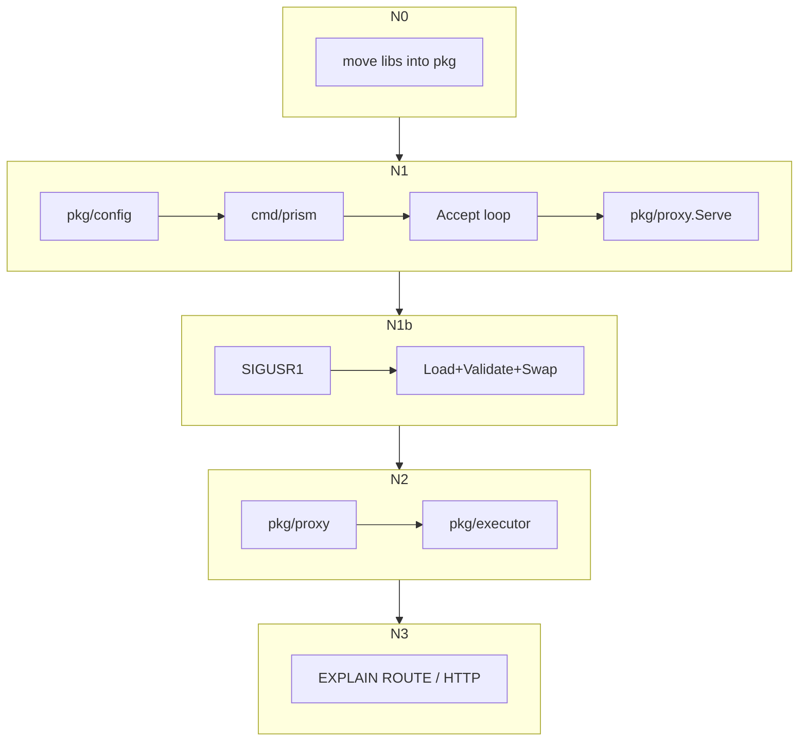

# M1 下一阶段：可运行进程 + 管线显式化（源码调研与设计）

> 状态：**已定优先切片，进入实现** — EXPLAIN 形态仍调研中；Prometheus 后置。  
> 日期：2026-10-30  
> 调研方式：浅克隆到 `/tmp/prism-oss-survey/{kingshard,dbpack,Gaea,go-mysql}` **直接读源码**（非 README/记忆）。  
> 上位：[m1-passthrough-pipeline-design.md](m1-passthrough-pipeline-design.md)、[architecture.md](../architecture.md)  
> 现状：库级透传（`proxy.Serve` + 池/会话保真）已可用；**无 `cmd/prism`、无 `config/`、无 `executor/`**。

---

## 0. 一句话

下一阶段交付 **可手工连接的代理进程**，并把数据面收敛到 **Plan → Dispatch → Merge** 装配点。  
进程骨架以 **kingshard `main` + Accept 循环** 为模板，协议层继续用已有第一方 `mysql/`（对齐 go-mysql）；装配与命名参考 **dbpack 的 Listener↔Executor 解耦**；配置用 **单 YAML + `-config`**，并做 **进程内热加载**（抄 kingshard `SIGUSR1` → 重读 YAML → `UpdateConfig`）。  
目录采用 Go 常见的 **`cmd/` + `pkg/`**：可导入库代码一律放 `pkg/<domain>`（对齐 dbpack 与广泛 Go 工程习惯）；`cmd/prism` 只做装配。  
**不做多租户**：无 Gaea namespace / etcd / cc 两阶段；整机一份配置。拒绝 Vitess topo、ProxySQL 多层 DB、dbpack 分布式事务 etcd 作为 M1 默认。

---

## 1. 源码级调研（按仓库）

### 1.1 kingshard（`flike/kingshard`）

**入口**（`cmd/kingshard/main.go`）：

- `flag.String("config", "/etc/ks.yaml", …)` → `config.ParseConfigFile`
- 组装三件套：`server.NewServer(cfg)` + `web.NewApiServer` + `monitor.NewPrometheus`
- 信号：`SIGINT/TERM/QUIT` → `svr.Close()`；**`SIGUSR1` → 重读 YAML + `svr.UpdateConfig`**
- 阻塞在 `svr.Run()`；API/Prometheus 另起 goroutine

**配置**（`config/config.go`）：

- 纯 YAML struct：`addr`、`user_list`、`nodes[]`（master/slave 字符串）、`schema_list[]`（按 user 绑 nodes + shard 规则）
- `yaml.Unmarshal` **无严格未知字段拒绝**；校验分散在 `NewServer`（charset、user 必须有 schema 等）

**Accept / 会话**（`proxy/server/server.go` + `conn.go`）：

```text
Run: for { Accept → go onConn }
onConn: Handshake → schema = GetSchema(user) → conn.Run()
Run: loop ReadPacket → dispatch(cmd)
dispatch: COM_QUIT/PING/INIT_DB/QUERY/STMT_* …
```

- **goroutine-per-connection**（`go s.onConn(conn)`）
- 命令分发是巨大的 `ClientConn` 方法集（`handleQuery` / `preHandleShard` / `mergeSelectResult`…），**协议 + 路由 + 归并搅在同一类型**

**热加载**（`UpdateConfig`，`proxy/server/server.go`）：

- 先完整 parse blacklist / allowips / nodes / schemas / users；任一步失败 **直接 return**，不改运行态
- 成功后 `configUpdateMutex` 下替换；blacklist/allowips 用 **双缓冲 + atomic index**；nodes 旧 offline 后整表换；`configVer++`

**后端池**（`backend/db.go`、`backend_conn.go`）：

- `BackendConn.Close()`：若无 pkgErr，先 **`ResetSession()` = `COM_RESET_CONNECTION`**，失败则丢弃，成功再 `PushConn` 入池  
  （与 prism 已实现的 Release→Reset 同思路，kingshard 注释写明对齐 `database/sql` SessionResetter）
- `IsInTransaction()` 读 `SERVER_STATUS_IN_TRANS`（与我们刚做的 status sticky 一致）

**对 prism**：

| 抄 | 不抄 |
|---|---|
| `main`：`-config` → NewServer → Accept 循环 → 信号退出；可选独立 metrics/admin goroutine | 自研整包 `mysql/`（我们已第一方对齐 go-mysql） |
| 归还池前 `COM_RESET_CONNECTION` | `ClientConn` 上帝对象；多节点 mergeSelect 全量缓冲路径 |
| YAML 扁平启动配置；**SIGUSR1 热更**（失败保留旧配置） | 无严格 unknown field；按 user 绑多 schema 的多租户味道 |

---

### 1.2 dbpack（`CECTC/dbpack`，`dev` 分支）

**入口**（`cmd/cmd.go`）：

- Cobra：`dbpack start -c FILE`
- `config.Load` → 按 `AppConfig` 注册 Filter → `RegisterDBManager`（DSN 池）→ 按 mode 建 Executor（`SDB`/`RWS`/`SHD`）→ Listener `SetExecutor` → `server.Start(ctx)`
- **优雅退出**：第一次信号后 `Sleep(TerminationDrainDuration)` 再 `cancel`；第二次信号直接 `os.Exit(1)`
- 默认另开 HTTP probe（Prometheus/API，默认 `:18888`）

**配置**（`pkg/config/config.go` + `db.go`）：

```yaml
# 真实样例结构（dbpack-samples/config-product.yaml）
probe_port / termination_drain_duration / tracer
app_config:
  <appid>:
    listeners: [{ protocol_type: mysql, socket_address, config.users, executor: name }]
    executors: [{ name, mode: sdb|rws|shd, config }]
    data_source_cluster: [{ name, capacity, max_capacity, idle_timeout, dsn, … }]
    filters: […]
    distributed_transaction: { etcd_config… }   # M1 不做
```

- `Normalize()` 校验：listener 引用的 executor 必须存在、datasource 完整等（**比 kingshard 严格**）
- 池字段命名与 prism/`Gaea` 同源：`capacity` / `max_capacity` / `idle_timeout`

**Listener**（`pkg/listener/mysql.go`）：

- `Listen`: `Accept` → `go handle`（同样 per-conn）
- `handle`: handshake → OK → loop `ReadEphemeralPacket` → `ExecuteCommand` → **委托 `executor`**
- Listener **不**做分片；只做协议

**Executor 接口**（`pkg/proto/interface.go`）：

```go
ExecutorComQuery / ExecutorComStmtExecute / ExecuteUseDB /
InLocalTransaction / ConnectionClose / GetPreFilters…
```

- `SingleDBExecutor`（`pkg/executor/single_db.go`）：按 AST 分支 `Begin/Commit/Rollback/Set`，事务句柄存在 `localTransactionMap`；普通查询 `db.Query`
- 分片路径另有 `pkg/plan`（如 `DirectQueryPlan` Restore AST 再下发）+ `pkg/optimize`

**Server**（`pkg/server/server.go`）：仅管理多个 Listener 的 `Listen`/`Close`，极薄。

**对 prism**：

| 抄 | 不抄 |
|---|---|
| **Listener（协议）与 Executor（转发/计划）解耦**；cmd 里按名装配 | etcd 分布式事务、Filter 全家桶、多 AppID mesh |
| `termination_drain_duration` 二次信号语义 | 后端走 `database/sql`/connector 为主（我们坚持 raw `mysql/client`） |
| Executor mode 演进空间（sdb→未来 shard） | Cobra 非必须（`flag` 足够）；probe 端口可后置 |
| 配置 Normalize 校验；**`pkg/` 伞（prism 跟此目录习惯）** | JSON marshal 往返解析 executor 子配置；Filter/DT 全家桶 |

---

### 1.3 Gaea（`XiaoMi/Gaea`）

**入口**（`cmd/gaea/main.go`）：

- `-config` → `models.ParseProxyConfigFromFile`（**ini 本地配置**）
- `server.LoadAndCreateManager`（namespace 来自 file/etcd）→ `NewServer` → `Run`
- 信号与 kingshard 类似；`SIGUSR1` → `ReloadProxyConfig`（**仅**日志路径/级别/general logger 等 proxy 静态项）
- namespace 变更另走 `ReloadNamespacePrepare/Commit` + etcd/cc —— **多租户路径，M1 不做**

**Accept**（`proxy/server/server.go`）：`Accept` → `go onConn`（同模型）

**池**（`backend/connection_pool.go` + `direct_connection.go` + `executor.go`）：

- `tryReuse` → `ResetConnection()`（清事务/autocommit/charset/sql_mode 等）
- 借出后 **`initBackendConn`**：按会话 `USE` + charset/collation + session variables 批量对齐  
  （与 M1 已定「Release Reset + Acquire Align」双保险一致，Gaea 是对齐侧的主参考）

**对 prism**：抄 **借连对齐 / tryReuse Reset** 语义（已在上一阶段落地）；日志级热更可参考 `ReloadProxyConfig`；**不抄** ini+etcd namespace、cc 两阶段、装饰器改写主路径。

---

### 1.4 go-mysql（`go-mysql-org/go-mysql`）

**入口**（`cmd/go-mysqlserver/main.go`）：教学用——`Listen` → **单次** `Accept` → `NewConn` → `HandleCommand` 循环；生产必须自己加 Accept 循环与 goroutine。

**价值**：`server.Handler` / `WritePacket` 头预留等 API 约定；prism 协议层已对照移植，**cmd 不要照抄单连接示例**。其根下按能力拆包（`mysql/`、`packet/`、`server/`）——prism 把同类包收拢到 `pkg/` 下，避免模块根被库包占满。

---

### 1.5 对照总表（进程 / 配置 / 管线）

| 维度 | kingshard | dbpack | Gaea | go-mysql server | prism M1 选定 |
|---|---|---|---|---|---|
| CLI | `-config` YAML | `start -c` YAML | `-config` ini | 无配置 | **`-config` YAML**（kingshard 形） |
| Accept | per-conn goroutine | per-conn goroutine | per-conn | 示例单连接 | **per-conn → `proxy.Serve`** |
| 协议实现 | 自研 `mysql/` | 自研 `pkg/mysql`+packet | 自研 | 库本身 | **已有第一方 `mysql/`** |
| 业务解耦 | 弱（ClientConn 巨大） | **强 Listener↔Executor** | Session+plan 包 | Handler 回调 | **引入 executor 装配点（dbpack 形）** |
| 池 reset | COM_RESET 归还 | 资源管理器+TX map | ResetConnection + initBackendConn | N/A | **已实现 Reset+Align** |
| 热更 | **SIGUSR1 → UpdateConfig** | etcd/filter；本地 YAML 偏静态 | SIGUSR1 只热更日志；namespace 走 etcd+cc | N/A | **SIGUSR1 热更本地 YAML**（无 namespace） |
| 多租户 | schema_list 按 user | 多 executor/app | **namespace + etcd** | N/A | **不做** |
| 目录形态 | 根下扁平包 | **`pkg/` 伞下扁平** | 根下扁平包 | 根下按能力扁平 | **`cmd/` + `pkg/`**（跟 dbpack / 常见 Go 布局） |
| 分片/事务 | schema shard + 内存 merge | SHD plan + DT/etcd | namespace 规则 | N/A | **M1 不做；接口预留** |

另：MySQL Router / MaxScale / ShardingSphere-Proxy / Atlas / OBProxy——不作为 M1 进程骨架来源。

### 1.6 目录 / 包布局（源码对照）

| 仓库 | 形态 | 典型顶层 |
|---|---|---|
| **kingshard** | 模块根扁平 | `cmd/kingshard`、`config/`、`mysql/`、`backend/`、`proxy/{server,router}`、`monitor/`、`web/`、`sqlparser/`、`etc/` |
| **Gaea** | 模块根扁平（与 kingshard 同构） | `cmd/gaea`、`models/`（配置）、`mysql/`、`backend/`、`proxy/{server,plan,router}`、`parser/`、`stats/`、`cc/`、`etc/` |
| **go-mysql** | 模块根按能力扁平 | `cmd/*`、`mysql/`、`packet/`、`server/`、`client/`、`replication/`… |
| **dbpack** | **`pkg/` 伞** + 瘦 `cmd/` | `pkg/{config,listener,executor,server,plan,mysql,packet,proto,…}` |

**结论（已改）**：代理专项目录上 kingshard/Gaea 偏根下扁平，但 **Go 工程更常见的是 `cmd/` + `pkg/`**（库代码可被外部 import 的约定位置；dbpack 即此）。prism **选定 `pkg/`**：既有 `mysql/`、`pool/`、`proxy/`、`session/`、`sql/` **迁入 `pkg/`**，新增包也只在 `pkg/` 下生长。`test/`、`docs/`、`etc/`、`cmd/` 仍留在模块根。

**职责落点对照（M1）**：

| 职责 | kingshard | Gaea | dbpack | prism（选定） |
|---|---|---|---|---|
| 进程入口 | `cmd/kingshard` | `cmd/gaea` | `cmd/` | **`cmd/prism`** |
| 配置 | `config/` | `models/` | `pkg/config` | **`pkg/config`** |
| Accept / 会话 | `proxy/server` | `proxy/server` | `pkg/listener`+`server` | **`pkg/proxy`**（现有 Serve 迁入）；main 只 Listen/Accept |
| 执行 / Plan | 揉进 ClientConn | `proxy/plan` | `pkg/executor`+`plan` | **`pkg/executor`**（勿塞进 proxy） |
| 路由 | `proxy/router` | `proxy/router` | plan 内 | M1 Noop；预留 **`pkg/router`** |
| 后端池 | `backend/` | `backend/` | `pkg/resource` | **`pkg/pool`**（不改名为 backend） |
| 管理 / 指标 | `web/`+`monitor/` | admin+`stats/` | `pkg/http` | **`pkg/admin`**、**`pkg/obs`** |
| 示例配置 | `etc/` | `etc/` | `docker/conf` | **`etc/`**（无 Go import） |

依赖方向（import path 加 `pkg/` 前缀后不变）：`pkg/mysql` ← `pkg/session`/`pkg/pool` ← `pkg/sql`/`pkg/router` ← `pkg/executor`；`pkg/config` 被装配与读快照方引用；`pkg/mysql` 不 import `pkg/executor`。

---

## 2. 目标与非目标

### 2.1 目标

1. `go run ./cmd/prism -config …` 可连，透传可用。
2. `config` 强类型加载 + **校验**（未知字段拒绝；`sharding` warn 忽略）。
3. Accept 循环装配现有 `proxy.Serve`；信号优雅退出（参考 dbpack drain + kingshard Close listener）。
4. **配置热加载**：`SIGUSR1` 重读同一 `-config` 路径 → `Validate` → 原子替换运行时快照；失败保留旧配置并打错误日志。
5. N2 起：`executor` 装配点（NoopRouter / PassthroughPlan / IdentityMerger），满足 A5。
6. N3：`EXPLAIN ROUTE` + HTTP explain（Vitess VEXPLAIN「只规划」语义），满足 A4。

### 2.2 非目标

- **多租户 / 多 namespace**：Gaea etcd + `ReloadNamespacePrepare/Commit`、按租户隔离的用户地图与后端拓扑  
- dbpack 分布式事务 / etcd 配置中心；用 etcd/Consul 做配置源（热更只读**本地 YAML**）  
- 把库包再拆进 `internal/`（M1 无必要）；把 `pool` 改名为 `backend`  
- kingshard 式多节点结果全量 merge  
- ProxySQL 多层配置、Vitess topo  
- TLS、caching_sha2 full-auth、gnet  

---

## 3. 推荐实现分期

| 切片 | 内容 | 主要抄自 | 退出 |
|---|---|---|---|
| **N0** | 现有根包迁入 `pkg/`（`mysql`/`pool`/`proxy`/`session`/`sql`） | dbpack `pkg/`；Go `cmd`+`pkg` | **已完成** |
| **N1** | `pkg/config` + `cmd/prism` + `etc/`；Listen/Accept → `pkg/proxy.Serve` | kingshard main；dbpack drain | mysql 客户端 `SELECT 1` |
| **N1b** | `SIGUSR1` 热加载 + 字段契约（§4.3） | kingshard `UpdateConfig`；失败不换配置 | `kill -USR1` 改 users/log 生效；listen/backend 变更则失败 |
| **N2** | `pkg/executor` + Noop/Identity；proxy 走装配 | dbpack Listener↔Executor；Vitess Plan 退化 | A5；差分不回归 |
| **N3** | `pkg/admin`：`EXPLAIN ROUTE` + HTTP（**形态待调研定稿**） | Vitess 等续研 | A4 |
| **N4** | `pkg/obs`：Prometheus（**明确后置**） | — | — |



---

## 4. 包与装配（拟增）

### 4.0 M1 落地目录（`cmd/` + `pkg/`）

```
prism/
├── cmd/prism/                 # NEW：flag、信号、Listen/Accept、装配
├── pkg/
│   ├── mysql/                 # N0 迁入：packet、auth、server、client
│   ├── pool/                  # N0 迁入
│   ├── session/               # N0 迁入
│   ├── proxy/                 # N0 迁入：Serve
│   ├── sql/                   # N0 迁入
│   ├── config/                # N1：schema / load / validate / reload 快照
│   ├── executor/              # N2：plan / dispatch / merge
│   ├── admin/                 # N3：EXPLAIN HTTP
│   └── obs/                   # N4：slog 辅助、Prometheus
├── etc/                       # NEW：示例 prism.yaml（无 Go import）
├── docs/
└── test/                      # 仍在根：differential / handshake / passthrough
```

**刻意不做**：不把 `pool` 改名为 `backend`；不把 Plan/Merge 塞进 `pkg/proxy`；不建 `models/etcd` / `cc/`；M1 不强制再套一层 `internal/`。

### 4.1 `cmd/prism` 伪流程（源码对照后）

```text
flag -config
cfg = config.Load+Validate          // 严于 kingshard Unmarshal
runtime = atomic.Store(Snapshot)    // users / log / pool 上限等
slog setup
pool = pool.New(…, DialMySQL(backend))
ln = net.Listen(cfg.Listen)         // listen 仅启动时绑定
go signalLoop:
  SIGINT/TERM/QUIT → shutdown
  SIGUSR1 → Load+Validate；成功则 Swap，失败保留旧快照   // kingshard main.go:149-156
for {
  c, err = ln.Accept()
  go proxy.Serve(ctx, c, SessionConfig{ Runtime.Load(), Pool, Exec })
}
on shutdown: cancel; ln.Close; TerminationDrain; pool.Close
```

### 4.2 EXPLAIN 输出（草案）

单列 JSON（对齐 VEXPLAIN 习惯），字段：`plan_kind`、`targets`、`parsed`、`reserved_hint`、`reject`。

### 4.3 配置热加载契约（N1b）

**触发**：`SIGUSR1` → 重读 `-config` 路径 → `Validate` → 成功则原子替换；失败不替换。  
不做文件 watch（半写风险）；不做 etcd；**无** Gaea namespace 两阶段。

| 项目 | 行为 | prism 取舍 |
|---|---|---|
| kingshard `UpdateConfig` | 先 parse 全成功，再 mutex 下换 users/nodes/schemas；blacklist 双缓冲 | 抄失败早退 + 原子换快照；M1 可用 `atomic.Pointer[Config]` |
| Gaea `ReloadProxyConfig` | 只热更日志等静态项 | 日志级别可抄；不抄 namespace |
| dbpack | 无同款 USR1 本地热更 | 不作为模板 |

**字段分级**：

| 级别 | 字段（拟） | 行为 |
|---|---|---|
| 热更生效 | `users`、`log.level` | 新连接/下次鉴权见新快照；已建连不强制踢 |
| 热更尽力 | `pool` 上限类 | 能 Apply 则 Apply；做不到则 warn 保持旧值 |
| 须重启 | `backends` 地址/账号、`listen`、admin listen | **变更则整次 reload 失败**（避免半切池 / 静默旧 listen） |

**测试**：`config` Load/Validate；Runtime Apply 表驱动；抽出 `Reload(path)` 单测，不依赖真发信号为唯一路径。

---

## 5. 决策表（锁定）

| ID | 议题 | 选定 | 源码依据 |
|---|---|---|---|
| **E1** | Accept 模型 | per-conn goroutine → `pkg/proxy.Serve` | kingshard `Server.Run`；dbpack `MysqlListener.Listen` |
| **E2** | CLI/配置 | 单 YAML + `-config`；严格校验；**非多租户** | kingshard/dbpack YAML；校验学 dbpack `Normalize` |
| **E3** | 模块边界 | 协议（`pkg/proxy`/`pkg/mysql`）与 `pkg/executor` 解耦 | dbpack Listener↔Executor；避免 ClientConn 上帝对象 |
| **E4** | 池语义 | 保持 Reset+Align | kingshard `ResetSession`；Gaea `tryReuse`+`initBackendConn` |
| **E5** | 管线语义 | Vitess Plan 退化 Noop；非 Gaea 装饰器 | 已有 M1 决策 |
| **E6** | 优雅退出 | drain + 二次信号强硬退 | dbpack `cmd.go` |
| **E7** | 明确不做 | 多租户 namespace/cc、DT/etcd 配置中心、全量 merge、topo | Gaea cc；dbpack DT；kingshard merge |
| **E8** | 配置热加载 | `SIGUSR1` + 本地 YAML；字段分级 §4.3 | kingshard `UpdateConfig`；Gaea 静态项对照 |
| **E9** | 目录形态 | **`cmd/` + `pkg/`**；库代码均在 `pkg/`；N0 迁现有根包 | dbpack；Go 常见可导入库布局 |

---

## 6. 评审结论（2026-10-30）

| 项 | 结论 |
|---|---|
| 实现顺序 | **`cmd/prism` + `pkg/config`（含简单热更）**；库代码均在 `pkg/`（N0 已迁）；executor / EXPLAIN 再后 |
| 热更边界 | listen / backend 变更 → reload **失败须重启**；users / log.level 热更生效（简单版） |
| 目录 | **已定 `cmd/` + `pkg/`**；现有库包已迁入 `pkg/` |
| EXPLAIN 形态 | **继续调研**，本切片不实现、不定死 JSON |
| Prometheus | **再靠后**（原 N4 继续后置） |

下一步：TDD 实现 `pkg/config` → `cmd/prism` → 简单 `SIGUSR1` Reload。

---

## 7. 参考（源码路径均相对 `/tmp/prism-oss-survey`）

| 仓库 | 关键文件 |
|---|---|
| kingshard | `cmd/kingshard/main.go`，`config/config.go`，`proxy/server/{server,conn}.go`（含 `UpdateConfig`），`backend/{db,backend_conn}.go`，`etc/ks.yaml` |
| dbpack | `cmd/cmd.go`，`pkg/config/config.go`，`pkg/proto/interface.go`，`pkg/listener/mysql.go`，`pkg/executor/single_db.go`，`pkg/server/server.go`，`pkg/plan/direct.go` |
| Gaea | `cmd/gaea/main.go`，`proxy/server/server.go`（`ReloadProxyConfig`），`backend/connection_pool.go`，`proxy/server/executor.go`（`initBackendConn`） |
| go-mysql | `cmd/go-mysqlserver/main.go`，`server/`、`packet/`、`mysql/` |

外部文档补充：Vitess VEXPLAIN、ProxySQL 多层配置、MySQL Router bootstrap、MaxScale listener/service——仅作边界对照，未作 M1 实现模板。
